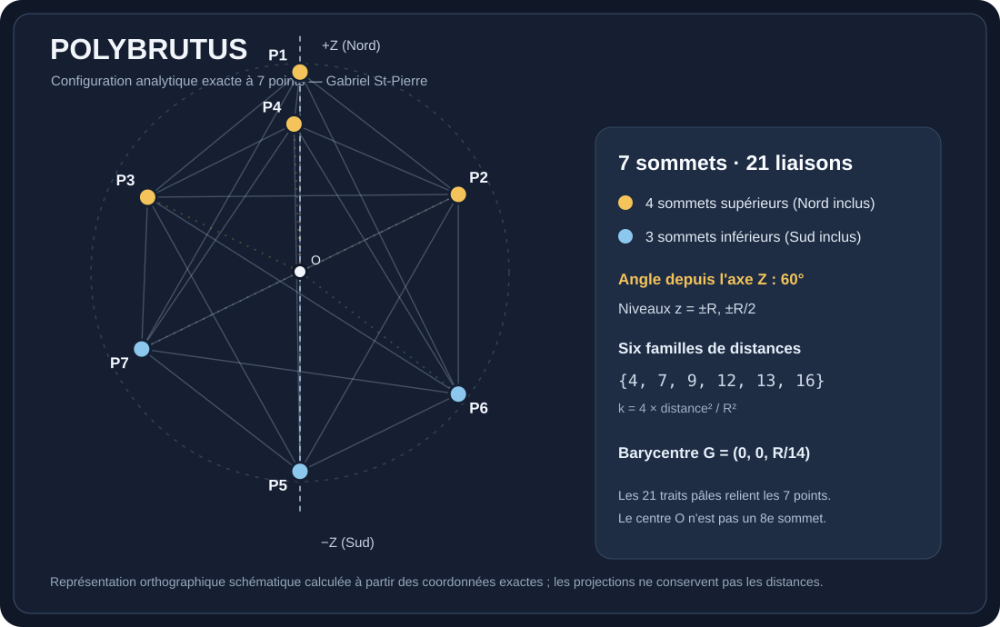

# Polybrutus — configuration exacte à sept points

**Concepteur du modèle documenté : Gabriel St-Pierre (Topbrutus)** · **Version de travail : 0.1.0** · **Statut : documentation et vérification, non publié sur Zenodo**

> Sept points sur une même sphère, un axe vertical, une construction angulaire à 60° et vingt-et-une distances organisées en six familles mathématiques exactes.



## Comprendre en 30 secondes

Le **Polybrutus** est le nom donné par Gabriel St-Pierre à la configuration de référence à **sept points** qu'il a étudiée et modélisée en trois dimensions. Les points sont répartis en **quatre sommets dans l'hémisphère supérieur** (pôle Nord compris) et **trois dans l'hémisphère inférieur** (pôle Sud compris). Les trois points supérieurs hors pôle sont à 60° de +Z, séparés dans leur azimut de 120°. Les deux points inférieurs hors pôle sont à 60° de −Z et se trouvent dans le plan XZ, de part et d'autre de l'axe. Le centre de la sphère **O = (0,0,0)** est un repère et **n'est pas un huitième sommet**.

Les sept points forment un **graphe complet de 21 liaisons** : chaque point est relié aux six autres. Cela **ne** représente pas un heptagone plan régulier et **ne** représente pas le prisme heptagonal ouvert étudié dans un dépôt distinct.

## Caractéristiques mesurables

| Propriété | Valeur exacte |
|---|---|
| Sommets sur la sphère | **7** |
| Rayon du centre à chaque sommet | **R**, avec R > 0 |
| Liaisons entre toutes les paires | **21 = 7 × 6 / 2** |
| Niveaux horizontaux | **z = R, R/2, −R/2, −R** |
| Angles polaires de la construction | **60°**, depuis +Z / −Z |
| Azimuts des trois points hauts | **0°, 120°, 240°** |
| Plan des deux points bas intermédiaires | **XZ : y = 0** |
| Barycentre des sept sommets | **G = (0,0,R/14)** |
| Distances distinctes | **6 familles** |
| Échelle | Valide pour tout R > 0 |

## Coordonnées analytiques

Choisir l'axe **Z** comme axe Nord–Sud et le centre **O=(0,0,0)**. Les coordonnées sont écrites exactement, sans approximation :

| Point | Nom | x/R | y/R | z/R |
|---|---|---:|---:|---:|
| P1 | Nord | 0 | 0 | 1 |
| P2 | Haut-1 | √3/2 | 0 | 1/2 |
| P3 | Haut-2 | −√3/4 | 3/4 | 1/2 |
| P4 | Haut-3 | −√3/4 | −3/4 | 1/2 |
| P5 | Sud | 0 | 0 | −1 |
| P6 | Bas-1 | √3/2 | 0 | −1/2 |
| P7 | Bas-2 | −√3/2 | 0 | −1/2 |

**Vérification :** pour chaque sommet P, **x²+y²+z²=R²**. Le rayon peut changer sans modifier les rapports des distances ni les angles.

## Pourquoi 60° ?

À 60° du pôle supérieur, la hauteur d'un sommet vaut **z = R cos 60° = R/2** et son rayon horizontal vaut **r = R sin 60° = √3 R/2**. La construction inférieure est son pendant depuis le pôle Sud : **z = −R/2**. Le nombre 60° est donc un angle **polaire relatif à l'axe vertical**, et non un angle de 60° entre chacune des 21 liaisons.

## Six familles de distances : une signature vérifiable

Sur les 21 segments, les longueurs ne prennent que six valeurs. Pour tout couple de sommets i < j, définir **k = 4‖Pᵢ−Pⱼ‖²/R²**. Alors k appartient exactement à **{4,7,9,12,13,16}**, avec les multiplicités suivantes :

| k | Distance | Nombre de segments | Avec R = 10 cm |
|---:|---|---:|---|
| 4 | R | 6 | 10 cm |
| 7 | (√7/2)R | 2 | 5√7 ≈ 13,2288 cm |
| 9 | (3/2)R | 3 | 15 cm |
| 12 | √3 R | 6 | 10√3 ≈ 17,3205 cm |
| 13 | (√13/2)R | 2 | 5√13 ≈ 18,0278 cm |
| 16 | 2R | 2 | 20 cm |
| **Total** | **6 familles** | **21** | |

La somme des sept coordonnées donne **Σx=0**, **Σy=0**, **Σz=R/2**, donc **G=(0,0,R/14)**. Ce barycentre est situé **au-dessus du centre de la sphère**, même si les sept sommets sont sur sa surface.

## Exploration et reproduction

Le code de référence disponible lors de la préparation est `generateur_7_pics_snap_exact_60_invariants.py` : sa commande **« Snap exact 60° »** produit les coordonnées analytiques décrites ici. La définition mathématique indépendante est reprise dans [SPECIFICATION.md](SPECIFICATION.md), et un vérificateur autonome se trouve dans [verify_polybrutus.py](verify_polybrutus.py).

Après installation de Python 3 :

```bash
python verify_polybrutus.py
```

Tous les calculs du vérificateur utilisent des entiers et des fractions pour éviter la dépendance aux tolérances des nombres flottants.

## Conception, provenance, droits et limites

**Nom de cette réalisation et concepteur de la configuration documentée : Gabriel St-Pierre (« Topbrutus »).** Attribution bibliographique : **St-Pierre, Gabriel**. ORCID : **0009-0009-9297-2336**.

Les **formules géométriques** et les identités de distance sont démontrables par l'algèbre. Leur validité ne suffit **pas** à établir que cette configuration est mathématiquement inédite, ni à conférer un brevet ou une exclusivité sur les objets mathématiques. Une recherche d'antériorité et, si une propriété d'optimalité est revendiquée, une preuve appropriée sont nécessaires.

**La qualification « parfaite » décrit ici la configuration analytique exacte choisie**, non une optimalité mondiale démontrée. Aucune licence de réutilisation n'est encore accordée dans ce dépôt; son choix relève du titulaire des droits. **Zenodo : préparation seulement, aucune publication publique ni DOI affirmés pour Polybrutus.** Le brouillon Zenodo concernant le prisme est une autre entrée.

---

**Questions, comparaisons et vérification indépendante bienvenues :** la valeur de cette définition est qu'elle est précise, reproductible et falsifiable.